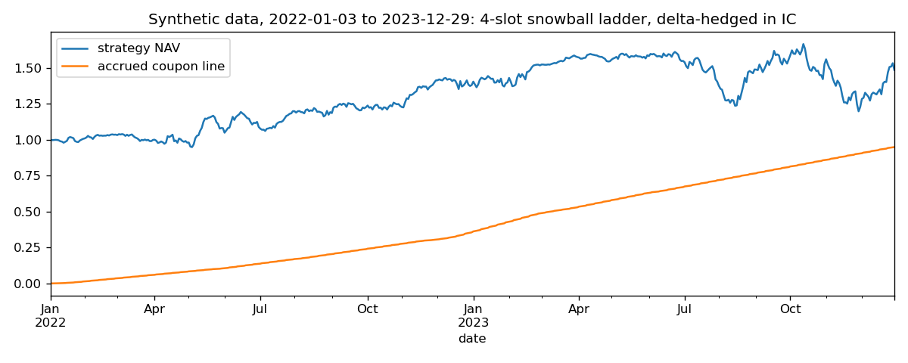
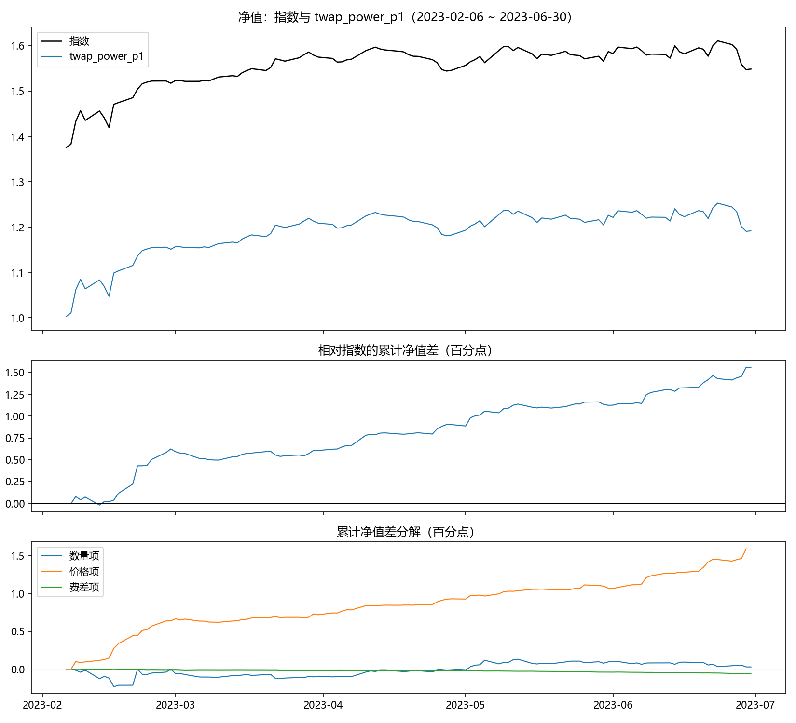

# Snowball Delta-Hedging Backtest

A research framework for pricing autocallable "snowball" notes and backtesting the
strategy that holds their model delta in CSI 500 index futures (IC). It works in two
layers:

1. **Index layer (daily).** Virtual snowballs are issued on a rolling ladder, each one's
   coupon is solved at issue, its delta is re-read every day from a PDE value surface,
   and the aggregate exposure is held in front-month futures with a multi-day roll. The
   result is a rule-based, look-ahead-free strategy index.
2. **Execution layer (minute bars).** The index assumes "signal at the close, fill at
   the settlement price", which is not tradable. The execution layer replays each day on
   one-minute bars with pluggable execution strategies, and decomposes every strategy's
   NAV difference to the index **exactly** into a quantity term (overnight position
   gap), a price term (fill price versus settlement price) and a fee term.

The code was written for a trading-desk research question. This public version ships the
complete framework, the pricing engines and the baseline execution strategies together
with a synthetic-data generator, so everything runs end-to-end without any licensed market
data. The original data, run archives and the desk's conclusions are deliberately not
included (see [What is not here](#what-is-not-here)).



*Two years of the four-slot ladder on synthetic data (see `examples/run_daily_backtest.py`).
Nothing in this figure is a market result.*

## Design principles

- **No look-ahead, enforced by construction.** Volatility and basis are T−1 estimates;
  knock-in and knock-out are confirmed at the close, so intraday signals use the previous
  close's state; minute volume profiles are rolling averages shifted by one day; each day
  settles yesterday's position before adjusting to today's target.
- **Identities as acceptance tests.** A degenerate execution strategy (close signal,
  settlement fill) must reproduce the daily index to machine precision, and the three
  decomposition terms must sum to the NAV difference day by day. Both checks are built
  into the framework and run in `examples/run_execution_demo.py`.
- **Two independent pricing engines, one terms object.** Monte Carlo (antithetic GBM,
  common random numbers for deltas) and a Crank–Nicolson PDE (two coupled value layers
  for the knocked-in and not-knocked-in states, region assignment at observation dates,
  Rannacher smoothing) consume the same `SnowballTerms`. The coupon is solved without
  root finding by exploiting the payoff's linearity in the coupon. Cross-checks and error
  magnitudes are documented in `docs/`.
- **Content-addressed PDE cache.** Every solved value surface is stored under a hash of
  its complete input (terms, coupon, valuation date, market parameters, grid, engine
  source), so unchanged configurations re-run in seconds and the execution layer reuses
  the index layer's curves at zero cost.
- **One execution strategy per file.** The framework (`DayContext`, strategy base class,
  shared accounting engine, decomposition) is fixed; strategies only decide orders.

## Quick start

```bash
pip install -r requirements.txt                 # Python >= 3.10
python scripts/make_synthetic_data.py           # ~10 s, writes data/raw/ (git-ignored)

python examples/price_snowball.py               # no data needed: MC vs PDE coupon, value, delta profile
python examples/run_daily_backtest.py           # 2-year ladder backtest; first run solves and caches PDE curves
python examples/run_execution_demo.py           # four execution strategies on synthetic minute bars

python scripts/batch_exec.py --tag demo         # full batch: archives per-strategy reports under output/
python scripts/sweep_exec.py --tag power        # parameter sweep over the power-weight family
```

Every module under `src/` also has a `__main__` self-test (`python src/pde_engine.py`,
`python src/hedger.py`, …) that exercises its invariants on whatever data is in `data/raw/`.

## Repository layout

```
src/                       dependencies point one way, top to bottom
  data_loader.py           raw files -> MarketData (index, futures, Shibor, common calendar)
  futures_chain.py         four listed contracts per day, slot logic, roll calendar, multi-day roll windows
  market_params.py         T-1 basis ("repo") and volatility estimates -> MarketSnapshot
  snowball_contract.py     SnowballTerms and observation calendars (monthly-date and weekly-grid)
  payoff.py                the five payoff cases, linear in the coupon
  mc_engine.py             antithetic GBM relative paths
  pde_engine.py            Crank-Nicolson two-layer solver, value and delta curves
  pricer.py                solve_coupon / value / delta facade over both engines
  curve_cache.py           content-addressed on-disk cache of PDE curves
  hedger.py                daily futures accounting: settle first, then rebalance; fees; notional modes
  backtest.py              rolling issuance (slot ladder), per-leg state machine, BacktestResult
  analytics.py             benchmarks and statistics with consistent NAV conventions
  intraday_data.py         minute bars, per-bar VWAP, synthetic settlement check
  vol_profile.py           last-hour minute volume shares, rolling and shifted
  execution.py             DayContext, ExecutionStrategy, shared accounting, run_execution, acceptance checks
  batch.py / diagnostics.py  archives, leaderboards, diagnostic exports
  strategies/              one file per execution strategy (see below)
scripts/
  make_synthetic_data.py   synthetic data in the exact loader schema
  batch_exec.py            batch runner (archives three artefacts per strategy)
  sweep_exec.py            parameter sweeps (summary table only)
  summarize_exec.py        shortlist spreadsheet maintenance
  compare_exec.py          side-by-side comparison of archived strategies
examples/                  three runnable walk-throughs (pricing, daily backtest, execution)
docs/
  daily_layer_implementation_zh.md   derivations, accounting rules and numerical validation of the daily layer
  figures/                 figures used in this README (all from synthetic data)
```

## Execution strategies included

| Strategy | File | Role |
|---|---|---|
| `MarketOnSignal` | `market_on_signal.py` | control: signal at 13:55, one fill at 14:00 |
| `TwapLastHour` | `twap_last_hour.py` | control: one-hour TWAP coinciding with the settlement window |
| `TwapTwoStage` | `twap_two_stage.py` | baseline: 13:55 signal, 14:55 correction |
| `TwapHourPace` | `twap_hour_pace.py` | even pacing with a parameterised recalculation time |
| `TwapPowerWeight` | `twap_power_weight.py` | slice weights ∝ time^power (front-, equal- or back-loaded) |
| `TwapVolProfile` | `twap_vol_profile.py` | slice weights from the rolling last-hour volume profile |
| `TwapPreWindow` | `twap_pre_window.py` | control: fills placed before the settlement window |

All strategies share `ExecutionConfig` (fill at bar VWAP or bar close, fee rate) and are
compared on NAV, annualised return and Sharpe, with tracking error and information ratio
reported alongside. Adding a strategy means one new file plus one line in
`strategies/__init__.py`.



*One archived strategy report from `scripts/batch_exec.py` on synthetic data: NAV against
the index, the cumulative difference, and its exact three-term decomposition. Not a market
result.*

## Data

Real data are not distributed. `data/raw/` is git-ignored and is expected to hold:

| File | Content | Columns |
|---|---|---|
| `000905.SH.xlsx` | CSI 500 index, daily | `time, open, high, low, close` |
| `IC_daily_price.xlsx` | all listed IC contracts, daily, exactly four per day | `day, code, open, high, low, close, change, volume, amount, presettle, settle, oi` |
| `shibor.xlsx` | 1-year Shibor, percent | `time, value` |
| `csi500_index_1min.csv` | index, 1-minute closes | `date (YYYYMMDD), time (HHMMSS bar end), close` |
| `IC_quote_1min.csv` | IC contracts, 1-minute bars | `code, date, time, close, volume, value` |

Codes are `IC` + `yymm` (an exchange suffix such as `.CFE` is stripped). Minute bars are
labelled by their end time; each session has 240 bars (09:31–11:30, 13:01–15:00). The
index history must start about 250 trading days before the first futures date so the
volatility estimator is warm.

`scripts/make_synthetic_data.py` produces all five files in this schema from a GBM index,
an AR(1) basis around −8 % a year and U-shaped minute volumes, with the daily settlement
price defined as the volume-weighted average of the last hour of the minute bars so the
two layers agree exactly. It exists to exercise the code, not to resemble any market.

## Declared approximations

Full fills at the minute VWAP, no market impact, fractional lots in the index layer
(integer lots in the execution layer), no margin or cash-management return, and a
Monday-to-Friday calendar in the synthetic data. These are stated in the module
docstrings where they apply.

## What is not here

- The licensed market data the research was run on, and every artefact derived from it:
  run archives, order flows, result spreadsheets, notebooks with outputs, presentation
  material.
- Performance figures, the comparison of execution variants on real data, and the
  configuration that was eventually adopted. Those belong to the research context, not to
  the framework, and this repository makes no claim about them.
- Execution variants beyond the baseline family listed above.

## Language

The README is in English. Module docstrings, inline comments and the implementation notes
in `docs/` are in Chinese; they were written as working documentation and are kept as-is
because they are the most precise description of the mechanics.

## License

Code is released under the [MIT License](LICENSE). Any market data you supply remain
subject to their own terms of use.
